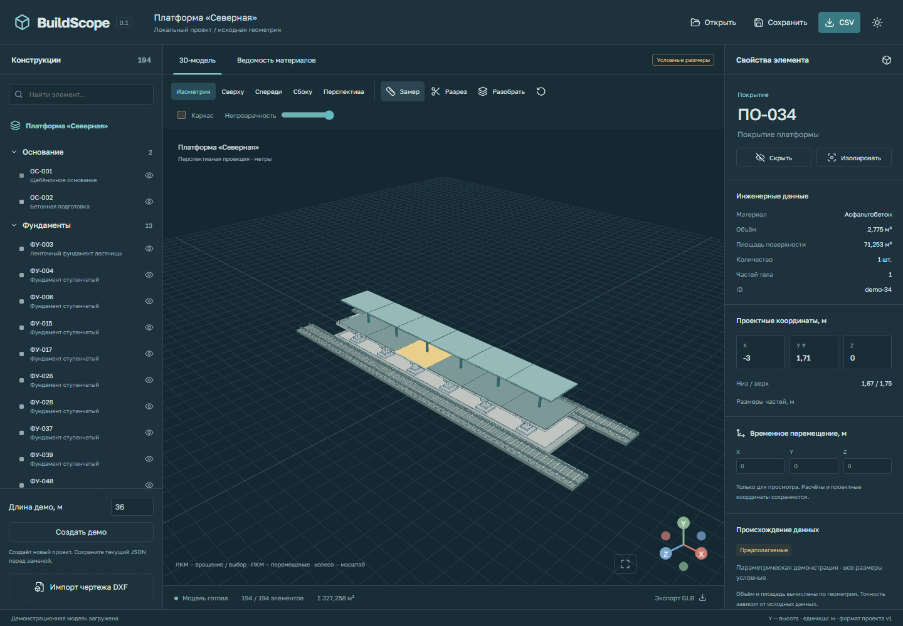

# BuildScope

Локальное приложение для исследования строительных конструкций. Первая специализация — пассажирские железнодорожные платформы. Windows 10/11, без Docker, Blender, сервера и платных API.

**Демонстрационные размеры, марки и материалы условные и не предназначены для строительства.**



## Windows

Установите Node.js **24 LTS** и Git. Клонируйте приватный репозиторий под своим аккаунтом GitHub:

```powershell
git clone https://github.com/csnicallyou/buildscope.git
cd buildscope
npm.cmd ci
.\start.ps1
```

Откройте http://127.0.0.1:5173 в актуальном Edge или Chrome с WebGL. Остановка: Ctrl+C. Если политика PowerShell блокирует скрипт, используйте `npm.cmd run dev`. Другой порт: `./start.ps1 -Port 5174`. Поддерживается Node 22.12+, локально проверено на 24.19.0. Интернет нужен при установке; приложение не использует внешние шрифты/API и не отправляет файлы на сервер.

## Возможности

- Параметрическая платформа 12–120 м с шагом 6 м. При 36 м — 194 элемента: щебёночное основание, бетонная подготовка, ленточный и ступенчатые фундаменты, опоры, балки, плиты, покрытие, лестница, навес, пути.
- Дерево категорий, поиск по названию/марке, инженерные свойства, размеры частей, материалы, отметки, исходные координаты и достоверность данных.
- Камеры: вращение/масштаб/перемещение, перспектива/орто, изометрия, сверху, спереди, сбоку. Выбор мышью или в дереве.
- Скрытие, изоляция, прозрачность, каркас, сечение X, разборка, временные смещения X/Y/Z и сброс.
- Замер между двумя точками на поверхностях; в разобранном виде измеряется отображаемое положение.
- Объёмы и полная площадь поверхности объединений прямоугольных частей, включая пересечения, ступени, полости и проёмы через разложение на части.
- Ведомость по материалам, подробный CSV для Excel, JSON v1 с валидацией, экспорт исходной геометрии с метаданными в GLB.
- ASCII DXF: LINE и прямые LWPOLYLINE/POLYLINE в отдельном 2D-просмотре, без реконструкции 3D.
- Тёмная/светлая темы и адаптивная компоновка.

## Использование

Щелчок выбирает элемент. Перетаскивание ЛКМ вращает камеру, ПКМ перемещает, колесо меняет масштаб. «Изолировать» оставляет выбранный элемент; повторное нажатие возвращает остальные. «Сбросить перемещения» также восстанавливает видимость и выключает разборку. Кнопка в нижнем углу 3D-поля возвращает изометрию и вписывает видимые объекты.

«Замер»: выберите две точки на поверхностях. Третья начинает новый замер. «Разрез»: ползунок меняет положение плоскости X.

«Сохранить» скачивает исходный проект JSON. Временные смещения, камера, тема, видимость и замеры не сохраняются. GLB также использует все элементы в исходных положениях. DXF существует отдельно в памяти и после перезагрузки открывается повторно.

**Сначала сохраните JSON перед созданием нового демо или открытием проекта.** Эти действия заменяют текущий проект; автосохранения нет.

## Ограничения

DWG/PDF/IFC и автоматическая реконструкция чертежей пока отсутствуют. Геометрия v1 — объединение осевых параллелепипедов, без вращения, BRep, произвольных мешей и CSG. Пересечения частей одного элемента учитываются; пересечения разных элементов не вычитаются. Площадь — поверхность тела, не площадь покрытия/опалубки.

Разрез без заливки, замер без привязки к вершинам, нет связи выбора 3D с линией чертежа. DXF показывает XY-проекцию без перевода единиц; выводится исходный код `$INSUNITS`. Тексты, размеры, блоки, дуги и кривые пропускаются с предупреждением. `parentId` и `sourceRef` сохраняются, но не образуют вложенное дерево или интерактивную связь с листом.

## Проверки

```powershell
npm.cmd run typecheck
npm.cmd run lint
npm.cmd test
npm.cmd run build
npx.cmd playwright install chromium
npm.cmd run e2e
```

Настроен GitHub Actions. Фактические результаты, включая блокировки облачного запуска: [PROJECT_STATE.md](PROJECT_STATE.md).

## Обновление через Git

Остановите сервер, сохраните JSON и локальные изменения кода:

```powershell
git switch main
git pull --ff-only
npm.cmd ci
.\start.ps1
```

При конфликтах не используйте `reset --hard`: сохраните изменения коммитом/stash и разберите конфликт.

Архитектура: [ARCHITECTURE.md](ARCHITECTURE.md). Формат данных: [DATA_MODEL.md](DATA_MODEL.md). Разработка: [DEVELOPMENT.md](DEVELOPMENT.md). Передача: [AGENTS.md](AGENTS.md), [PROJECT_STATE.md](PROJECT_STATE.md), [HANDOFF.md](HANDOFF.md).
