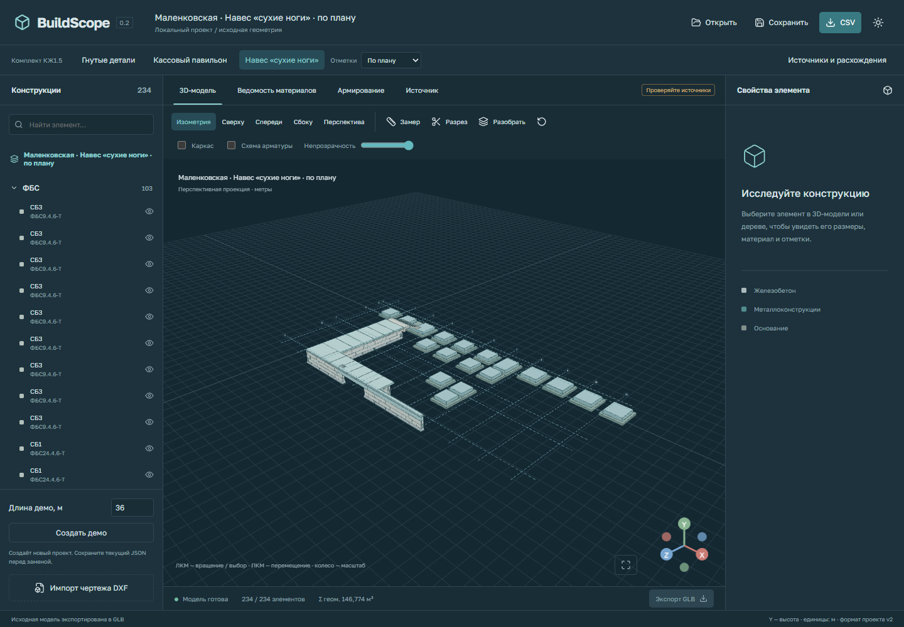

# BuildScope 0.3

Локальный инженерный 3D-просмотрщик на React / TypeScript / Three.js. Windows 10/11, без Docker, Blender и платных API.

Приватный просмотр с телефона: [BuildScope](https://buildscope-kzh-mobile.csnicallyou.chatgpt.site). Войти тем же аккаунтом ChatGPT; компьютер не требуется. Обновления GitHub сами по себе не публикуются в Sites.

## Реконструкция предоставленного КЖ1.5

По предоставленному PDF подготовлены три представления:

- Кассовый павильон: 168 элементов, включая 102 ФБС, 27 ФЛ, 12 плит и огибающие песчаной подготовки.
- Навес «сухие ноги»: 234 элемента, включая 103 ФБС, 31 ФЛ, 17 Фм, 14 плит, 3 балки, Лм1 и подготовку. Два варианта спорных отметок: по плану / по разрезам.
- Каталог 22 гнутых деталей: отдельные 3D-образцы по эскизам, с сохранением длин заготовок и позиций ведомостей.



Сборки открываются верхними кнопками. Нажатие на Фм или его подготовку выбирает весь объект; «Открыть отдельно» показывает только его части с собственной ведомостью и разборкой. «Ко всем объектам» возвращает общий вид. У ФЛ связана песчаная подготовка. В свойствах объекта суммируются материалы всех его тел и сталь по спецификациям; неизвестные количества помечены явно. Цемент отдельно не рассчитывается без рецептуры бетона. «Схема арматуры» показывает основные сетки/стержни и делает бетон прозрачным. Полная изготовительная расстановка каждой скобы, петли и нахлёста не утверждена. Геометрические объёмы, номинальные серийные изделия и количества исходной ведомости различаются явно. Неопределённые объёмы не заменяются нулями в свойствах/CSV.

**Это предметная ручная реконструкция данного комплекта, а не универсальное автоматическое восстановление PDF.** Исходник содержит разные отметки и округления. Все замечания доступны в разделе «Источник» и [реестре реконструкции](docs/RECONSTRUCTION.md). Положение двух объектов относительно друг друга не задано; они открываются в отдельных системах координат. Надземные конструкции, отсутствующие в КЖ, не домысливаются.

## Готовые файлы

В [output/projects](output/projects): павильон, навес по плану, навес по разрезам, каталог деталей. Для каждого есть JSON v2, готовый GLB, CSV геометрии и отдельный CSV исходных ведомостей. JSON содержит структуру, геометрию, источники, замечания и схемы армирования. Перегенерация JSON/CSV: `npm run export:projects`. GLB сохранены через кнопку «Экспорт GLB» для каждой сборки; при изменении геометрии обновить их отдельно.

Исходный PDF и растры листов не включены в Git. Для сопоставления выберите исходный PDF в разделе «Источник»; браузер показывает его локально и ничего не отправляет в сеть.

## Запуск на Windows

Установите Node.js 24 LTS и Git, затем под своим GitHub-аккаунтом:

```powershell
git clone https://github.com/csnicallyou/buildscope.git
cd buildscope
npm.cmd ci
.\start.ps1
```

Откройте http://127.0.0.1:5173 в Edge или Chrome с WebGL. Остановка: Ctrl+C. Другой порт: `./start.ps1 -Port 5174`. Если PowerShell блокирует скрипт, используйте `npm.cmd run dev`. Поддерживается Node 22.12+, проверено на 24.19.0. Интернет нужен при установке зависимостей; само приложение работает локально без внешних шрифтов/API.

Начальный вид — павильон. Ссылки: `/?assembly=canopy`, `/?assembly=canopy&variant=sections`, `/?assembly=details`. Старое параметрическое демо платформы: `/?demo=1` (все его размеры условные).

## Инструменты

ЛКМ выбирает поверхность, перетаскивание вращает камеру; ПКМ перемещает, колесо меняет масштаб. Камеры: перспектива/орто, изометрия, сверху, спереди, сбоку. Дерево, поиск, свойства, скрытие/изоляция, прозрачность, каркас, визуальное сечение X, разборка, временные смещения, замер по двум поверхностям и сброс.

Смещения не меняют проектные координаты и количества. Замер в разобранном виде относится к отображаемым положениям. JSON/GLB используют исходные положения и все элементы; GLB содержит также схемы арматуры. Состояние просмотра не сохраняется. DXF импортируется отдельно как XY-чертёж линейных сущностей, без реконструкции.

**Сохраните JSON перед созданием демо или открытием другого проекта**: эти действия заменяют текущую модель, автосохранения нет.

## Ограничения и проверка

Лм1 имеет схематический нижний профиль; огибающие подготовки и каталог деталей не входят в расчётные объёмы. ФЛ/ФБС номинальные, без полной заводской деталировки и подрезок по месту. Примыкания, швы/доборы и гидроизоляция без полного контура учтены по ведомости. Разрез без заливки, замер без snap. Общего импорта произвольных PDF/DWG/IFC пока нет.

```powershell
npm.cmd run typecheck
npm.cmd run lint
npm.cmd test
npm.cmd run build
npx.cmd playwright install chromium
npm.cmd run e2e
```

Фактические результаты: [PROJECT_STATE.md](PROJECT_STATE.md). CI настроен, но облачный запуск ранее блокировался биллингом аккаунта GitHub.

Обновление: остановить сервер, сохранить свои JSON и изменения кода, затем `git switch main`, `git pull --ff-only`, `npm ci`, `./start.ps1`. При конфликте не применять reset --hard.

Документы: [ARCHITECTURE](ARCHITECTURE.md), [DATA_MODEL](DATA_MODEL.md), [DEVELOPMENT](DEVELOPMENT.md), [AGENTS](AGENTS.md), [HANDOFF](HANDOFF.md).
