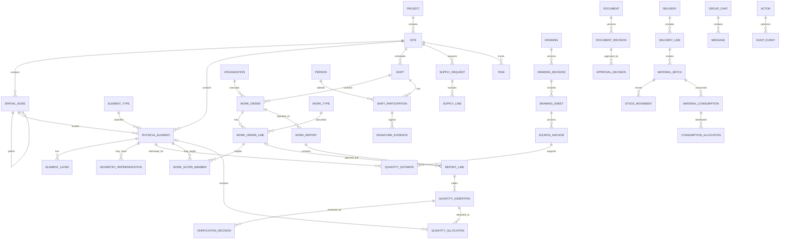

# BuildScope — ER-модель и словарь данных (этап 2)

**Статус:** проект архитектуры данных 0.2, для проверки сценариев. **Один новый продукт**, без версий Personal/Platform и без опоры на старое приложение. Физическую СУБД и API пока не выбираем.

## 1. Границы агрегатов

| Агрегат | Корень и дочерние записи | Обязательные ссылки |
|---|---|---|
| Строительный объект | Project → Site → SpatialNode (дерево зон/сооружений/конструкций) → PhysicalElement; ElementType, ElementLayer, ElementGroupMember | site_id, parent_id (кроме корня), type_id для типизированных элементов |
| Проектные данные | Drawing → DrawingRevision → DrawingSheet; SourceAnchor, DesignSnapshot, GeometryRepresentation, QuantityEstimate, ChangeProposal | revision_id и source_anchor для извлечённых значений |
| Работа и смена | WorkType, WorkScope, Shift, WorkOrder → WorkOrderLine, WorkReport → ReportLine, QuantityAssertion, VerificationDecision, QuantityAllocation | site_id, shift_id, work_type_id, единица измерения |
| Исполнители | Organization, Person, Crew, CrewMember, ShiftParticipation, TimesheetEntry, SignatureEvidence, EquipmentUse, Waybill | организация и смена, при наличии конкретный человек/машина |
| Снабжение и склад | SupplyRequest → SupplyLine; Delivery → DeliveryLine → MaterialBatch; StockMovement, MaterialConsumption, ConsumptionAllocation, InventoryItem, Handover, InventoryCount, DiscrepancyCase | site_id, material_id/asset_id, исходная операция |
| Документы | Document → DocumentRevision → Attachment; ApprovalFlow → ApprovalStep → ApprovalDecision | target_revision_id, actor_id, полномочие |
| Совместная работа | Task, TaskAssignment, GroupChat → Message, Comment, CalendarEvent, Notification, AutomationRule | context_ref, actor_id, scope |
| Аудит | Actor, OriginRecord, EvidenceLink, AuditEvent | entity_type, entity_id, timestamp, actor/source |

**Предлагаемые общие поля:** UUID `id`, `created_at`, `created_by`, `updated_at`, `revision` для изменяемых записей; `site_id` и `organization_id` там, где нужна область доступа; `origin_id` для сведений из источника. Не использовать одну универсальную таблицу для всех сущностей.

## 2. ER-диаграмма (логические связи)

Связь с группой элементов реализуется через `ElementGroupMember`; `WorkScopeMember` поддерживает также зону/конструкцию/объект без обязательного элемента. `ReportLine` без `WorkOrderLine` — дополнительная работа, а не ошибка.

## 3. Ключевые поля и ограничения

| Сущность | Основные поля | Ограничения |
|---|---|---|
| PhysicalElement | id, site_id, spatial_node_id, type_id?, mark?, instance_code, design_revision_id?, status | `instance_code` уникален в пределах объекта; `mark` не уникален; геометрия необязательна |
| ElementLayer | id, element_id, kind, sequence, material_id?, geometry_id? | отдельная готовность и работы каждого слоя |
| QuantityEstimate | id, target_ref, work_type_id?/material_id?, quantity?, unit_id, method, expression?, source_anchor_id?, certainty | null ≠ 0; расчёт отдельно от спецификации |
| Shift | id, site_id, local_date, starts_at, ends_at, shift_kind | `ends_at > starts_at` даже через полночь; хранить зону времени |
| WorkOrder | id, shift_id, contractor_id, status, issued_at?, issued_by?, document_revision_id? | выдача фиксирует снимок строк, последующие правки через редакции/аудит |
| WorkOrderLine | id, order_id, work_type_id, scope_id, planned_quantity?, unit_id, source | отсутствие плана допускается; нет подмены фактом |
| ReportLine | id, report_id, order_line_id?, work_type_id, scope_id?, reported_quantity?, unit_id, origin_id | незапланированная строка допустима; авторство сохраняется |
| QuantityAssertion | id, report_line_id, stage, quantity?, unit_id, asserted_by, asserted_at, origin_id | стадии planned/reported/verified/accepted не перезаписывают друг друга; planned обычно хранится в WorkOrderLine |
| VerificationDecision | id, assertion_id, decision, verified_quantity?, reason?, actor_id, decided_at | частичная проверка; не меняет исходное заявление |
| QuantityAllocation | id, assertion_id, element_id?, group_id?, allocated_quantity, unit_id, evidence_id? | сумма распределений ≤ исходный объём; не увеличивает факт |
| ShiftParticipation | id, shift_id, person_id?, crew_id?, reported_presence, observed_presence | нет сведений ≠ отсутствовал; человек может быть неизвестен |
| TimesheetEntry | id, participation_id, started_at?, ended_at?, hours?, origin_id | время, часы и подписи независимы |
| SignatureEvidence | id, participation_id, moment(start/end), status, attachment_id?, checked_by? | две независимые подписи, неизвестно/есть/нет/неразборчиво |
| EquipmentUse | id, shift_id, equipment_ref_id?, waybill_id?, scope_id?, hours?, source | госномер и часы могут быть неизвестны; не эксплуатационный учёт |
| SupplyRequest | id, site_id, requester_id, category, needed_at?, delivery_location?, status | связь с 3D необязательна |
| StockMovement | id, batch_id?, inventory_item_id?, from_location?, to_location?, quantity, unit_id, movement_kind, operation_key | уникальный operation_key, не считать заказ поставкой |
| MaterialConsumption | id, batch_id, quantity, unit_id, scope_id?, occurred_at, origin_id | списание один раз; allocation — только распределение |
| DocumentRevision | id, document_id, revision_no, file_ref, status, effective_at? | решения и источники закреплены за точной редакцией |
| ApprovalDecision | id, document_revision_id, step_id, actor_id, decision, timestamp | права проверяются на момент решения |
| Task | id, site_id, kind, context_ref?, status, owner_id?, acceptance_required | тип влияет на правила закрытия; история не удаляется |
| AuditEvent | id, actor_id?, entity_ref, action, before_ref?, after_ref?, occurred_at, origin_id? | append-only; фиксировать и автоматические действия |

## 4. Учёт объёмов и материалов — запрет двойного счёта

**Объём работы:** план из наряда, заявление из отчёта, решение проверки и формальная приёмка — разные факты. Проверка 10 м³ из заявленных 12 м³ создаёт подтверждённые 10 и спорные 2; исходные 12 остаются. Для агрегирования выбирается **одна стадия**, а не сумма стадий. Повторная проверка создаёт новую редакцию решения, не второй самостоятельный объём.

**Группа:** один подтверждённый объём 10 м³ на пять фундаментов остаётся одной записью. Можно распределить, например, 3 + 2 м³ по двум экземплярам, оставшиеся 5 м³ остаются групповыми. Общий итог всё ещё 10 м³. Не раскрашивать три оставшихся элемента как завершённые.

**Материалы:** партия 20 м³, выдача/расход 12 м³, последующее распределение 7 + 5 м³ по работам не создаёт дополнительных списаний. `StockMovement` и `MaterialConsumption` должны иметь общую ссылку на одну физическую операцию, иначе возникает риск двойного уменьшения остатков. Для учёта остатка использовать единый журнал физических движений, а `MaterialConsumption` — описание назначения расхода, **не вторую независимую операцию списания**.

## 5. Статусы и неизвестные значения

**Рекомендуемые (не утверждённые) состояния:**
- Наряд: draft → issued → in_progress → reported → partially_verified / verified → closed; blocked/cancelled — особые состояния с причиной.
- Отчёт: draft → submitted → in_review → partially_verified / needs_clarification / verified; приёмка отдельно.
- Заявка: draft → submitted → approved / rejected → ordered → partially_delivered / delivered → closed.
- Документ: draft → in_review → approved / returned → superseded / archived.
- Задача: open → assigned → accepted / declined → in_progress → ready_for_check → closed / reopened.

Статус «неизвестно» для факта/часов/геометрии **не заменять нулём**. Отсутствие вложения не означает отказ/невыход. Состояние строки отчёта и всего отчёта вычислять независимо. Нельзя автоматически приравнивать `verified` к `accepted`.

## 6. Права и аудит

Область права: субъект (пользователь/роль/организация), действие (read/create/edit/verify/accept/approve), объект доступа (проект/станция/зона/документ/работа). Подрядчик может создавать свои отчёты, но не подтверждать их как проверенные или принятые. Введённый координатором бумажный отчёт имеет `origin=paper_transcribed`, а не `origin=contractor_submitted`. Просмотр закрытого рабочего чата руководством — отдельное аудируемое событие.

## 7. Сквозная проверка требований

| Сценарий спецификации | Данные | Контроль |
|---|---|---|
| S1 вечер/утро | Shift, WorkOrder, Report, ReportLine, Evidence, Verification | выдача и построчная проверка не теряют исходник |
| S2 Фм2 | ElementType, PhysicalElement, ElementLayer, QuantityEstimate, QuantityAllocation | тип ≠ экземпляр, нет умножения группового факта |
| S3 редакция | DrawingRevision, SourceAnchor, ChangeProposal, DesignSnapshot | исторические факты не переписываются |
| S4 материалы | SupplyRequest, Delivery, Batch, StockMovement, ConsumptionAllocation | единое списание и остаток |
| S5 замечание | Task, Assignment, Comment, Message, AuditEvent | контекст и полномочия сохранены |
| S6 без 3D | WorkScope, WorkOrderLine, SpatialNode | mesh необязателен |
| S7 самостоятельный ввод | OriginRecord, WorkOrder, WorkReport | не требуется учётная запись подрядчика |
| S8 выход/подписи | ShiftParticipation, TimesheetEntry, SignatureEvidence | подписи, часы, выход не смешиваются |
| S9 путевой лист | EquipmentUse, Waybill, Shift | неизвестные часы не додумываются |
| S10 подключение подрядчика | Actor, OriginRecord, RoleGrant, WorkReport | те же записи, новая роль, без миграции продукта |

## 8. Решения, отложенные до физической схемы

Точная СУБД, способ хранения файлов и 3D, offline/sync, ID-стратегия между объектами, конкретные форматы импортов, таблицы разрешений и правила юридически значимой приёмки. Отдельно проверить единицы измерения, округления, отмены операций и конкурентное редактирование.

**Результат:** логическая ER-модель, словарь основных полей, инварианты и проверка десяти сценариев. Это проектное предложение для обсуждения; код не изменён.

## 9. Упрощение рабочего учёта по уточнению пользователя

**Приоритетное решение:** координатор сам устанавливает фактическое значение; основной интерфейс показывает **план, факт, остаток**. `WorkActual` — текущий установленный факт по работе/смене/области; `WorkActualRevision` — история корректировок. `WorkOrderLine` хранит план. Первоначальные заявления подрядчика сохраняются при наличии, но не требуют отдельной обязательной стадии. Формальная приёмка не блокирует учёт факта. Ранее описанные `VerificationDecision`/`AcceptanceDecision` — необязательная расширенная модель, **не обязательный рабочий маршрут**. Пример: план 12 м³, установленный факт 10 м³, остаток 2 м³.

## 10. Актуальная модель план/факт

См. [WORK_PROGRESS_MODEL.md](./WORK_PROGRESS_MODEL.md). Основные записи: `WorkTarget` (общий план), `WorkOrderLine` (план смены), `WorkActual` + `WorkActualRevision` (факт по смене с историей), `WorkActualAllocation` (распределение без повторного счёта). Накопительный факт — вычисляемый показатель, **не самостоятельная вводимая запись**. При противоречиях с ранней моделью четырёх стадий приоритет у этого решения и позднего уточнения пользователя.
