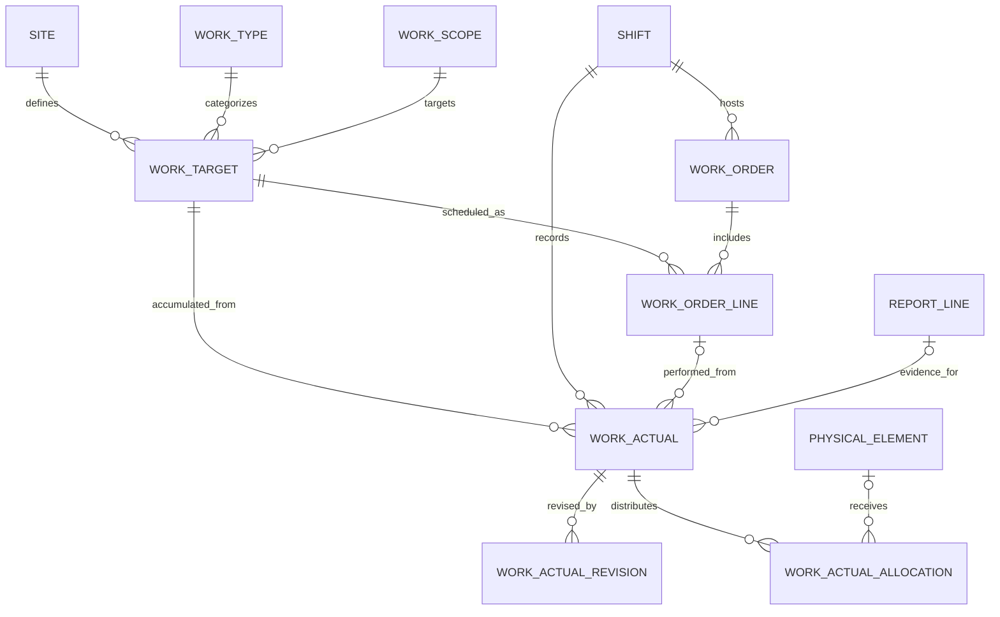

# BuildScope — рабочая модель план/факт и накопительный прогресс

**Статус:** проектное решение 19.11.2026. Пользователь делегировал выбор реализации с возможностью последующей корректировки. Один новый BuildScope; старое приложение не используется. Код не изменён.

## 1. Выбранный принцип

Факт вводится **по сменам и строкам работ**, а накопительные показатели **рассчитываются**, не вводятся повторно. Для рабочего координатора основной экран показывает **план / факт / остаток**. Отдельное обязательное утверждение руководителем после фиксации координатором факта не требуется.

Разделить:
- **Общий целевой объём** (`WorkTarget`) — объём конкретной работы на объекте/зоне/конструкции/группе, версия плана, единица и источник.
- **План смены** (`WorkOrderLine`) — сколько назначено выполнить в данную смену. Сумма планов смен не обязана равняться общему объёму: планы могут переноситься, отменяться и перекрываться.
- **Факт смены** (`WorkActual`) — сколько фактически выполнено в определённой смене по определённой работе; подтверждается координатором, допускается нулевой факт и неизвестное значение.
- **Накопительный факт** — сумма действующих фактов по одному `WorkTarget`, без двойного счёта групповых распределений.
- **Остаток** = общий целевой объём − накопительный факт; отрицательное значение отображается как перевыполнение, а не обрезается.
- **Первичное заявление подрядчика** (`ReportedWork`) — необязательное исходное свидетельство, может отличаться от установленного координатором факта. Сохранять оригинал и расхождения.

## 2. Основные связи и кардинальности

**Уникальность факта:** одна запись `WorkActual` описывает один атомарный эпизод выполнения, с собственным стабильным ID. В одной смене по одной работе может быть несколько эпизодов (разные подрядчики/участки), поэтому **не вводить ошибочный UNIQUE(shift_id, work_target_id)**. `source_line_identity`/идемпотентный ключ не допускает повторного импорта одного и того же эпизода.

**Основные поля:**
- `WorkTarget(id, site_id, work_type_id, work_scope_id, target_quantity?, unit_id, knowledge_state, plan_revision_id?, effective_from, effective_to?)`.
- `WorkOrderLine(id, order_id, work_target_id?, planned_shift_quantity?, unit_id, status, source_ref?)`. Допускаются внеплановые работы с последующей привязкой к цели.
- `WorkActual(id, site_id, shift_id, work_target_id?, order_line_id?, contractor_id?, scope_id, current_revision_id, origin_id, source_line_identity?)`.
- `WorkActualRevision(id, actual_id, quantity?, unit_id, knowledge_state, actor_id, recorded_at, occurred_at?, reason?, supersedes_revision_id?, source_ref?)`. Только **последняя действующая редакция** участвует в текущем итоге.
- `WorkActualAllocation(id, actual_revision_id, physical_element_id?, element_group_id?, allocated_quantity, unit_id)`: распределение **не добавляет** нового объёма.
- `ReportedWork(id, report_line_id, reported_quantity?, unit_id, origin_id, source_ref?)` — первичное заявление, если доступно.

## 3. Формулы и пример

По одному `WorkTarget` и одной совместимой единице:
- `shift_fact = SUM(current WorkActualRevision.quantity WHERE shift_id = selected_shift)`
- `cumulative_fact = SUM(current WorkActualRevision.quantity WHERE work_target_id = selected_target)`
- `remaining = target_quantity - cumulative_fact`
- `completion_ratio = cumulative_fact / target_quantity` **только при известном target_quantity > 0**. При нулевом/неизвестном плане процент не показывать.

| Смена | План смены | Факт смены | Накопительный факт |
|---|---:|---:|---:|
| Ночь 1 | 8 м³ | 6 м³ | 6 м³ |
| Ночь 2 | 7 м³ | 5 м³ | 11 м³ |
| Ночь 3 | 5 м³ | 4 м³ | 15 м³ |

При общем плане **20 м³** остаток **5 м³**. Сумма сменных планов в этом примере тоже 20 м³, но это совпадение **не является инвариантом**.

Если подрядчик заявил 6 м³, а координатор установил 5 м³, в накопительный факт идёт **5 м³**; 6 м³ сохраняются как первоначальное заявление. Исправление факта 5 → 4 м³ создаёт новую редакцию и уменьшает накопительный итог на 1 м³, **не прибавляет 4 к 5**.

## 4. Группы и предотвращение двойного счёта

Групповой факт принадлежит одной записи `WorkActual`. `WorkActualAllocation` указывает, какая часть этого **же** факта относится к конкретным элементам. Для одной редакции `SUM(allocations) ≤ quantity`. Нераспределённая часть остаётся видимой на уровне группы; агрегатор суммирует **исходные факты**, а не исходные факты плюс распределения.

Для одного физического объёма нельзя одновременно создать отдельный факт на группу и факты на её элементы. При переносе учёта на элементы меняется распределение существующего факта; дубли обнаруживаются по происхождению, времени, области работ и идентификаторам строк.

## 5. Редакции плана, отмены и корректировки

- Общий план меняется **версией `WorkTarget`**, а не перезаписью исторического значения. Накопительный факт сохраняется; текущий остаток пересчитывается по действующей версии плана.
- Отмена выданного наряда не удаляет уже подтверждённый факт; отмена ошибочного факта — новая редакция со статусом `void` и причиной.
- Неизвестный факт **не равен нулю** и не входит в сумму как подтверждённый ноль. Если часть эпизодов неизвестна, агрегат помечается **неполным**, даже если сумма известных значений показана.
- В разных размерностях объёмы не суммируются. Нельзя агрегировать м³, м², штуки в один «объём»; для сводной готовности нужен отдельно согласованный метод.
- Время смены хранится с временной зоной объекта; ночная смена остаётся одной записью, даже если пересекает полночь.
- Для незапланированной работы допускается `work_target_id = null`, но она должна быть видна в отчёте и журнале; её нельзя незаметно включить в процент выполнения другой цели.

## 6. Приёмочные тесты модели

1. Две ночи по 6 и 5 м³ → накопительный факт 11 м³.
2. Исправление второй ночи с 5 на 4 → накопительный факт 10 м³, история 5 сохранена.
3. Повторный импорт той же строки наряда → второй факт не создан.
4. Групповой факт 10 м³, распределение 3 + 2 → накопительный факт 10, нераспределённый остаток 5.
5. Неизвестный факт в третью ночь → итог известных фактов показывается как неполный.
6. План 20 → 18 м³ после редакции → факт не меняется, текущий остаток пересчитан.
7. План неизвестен → факт виден, процент и остаток «не определены».
8. Факт 22 при плане 20 → перевыполнение 2 м³, не ошибка арифметики.
9. Смена через полночь → факт относится к одной смене.
10. Подрядчик заявил 12, координатор установил 10 → текущий факт 10, исходное заявление 12 в истории.
11. Две записи одной смены по разным участкам → оба факта учитываются; уникальность по одной смене не блокирует их.
12. Работа без 3D и без исходного плана → факт доступен, но не приписан фиктивному элементу.

## 7. Совместимость с предыдущими черновиками

Ранние документы упоминали обязательные четыре стадии и отдельную формальную приёмку. **Для повседневного учёта это заменено более поздним решением пользователя**: план и установленный координатором факт, история исходных сообщений и корректировок. Юридические документы приёмки при необходимости ведутся отдельно, без блокировки учёта.

**Следующий шаг:** согласовать детали идентификации работ и границы их повторяемости; после этого — физическая модель и архитектура доступа. Не начинать реализацию до утверждения UX и технического плана.
